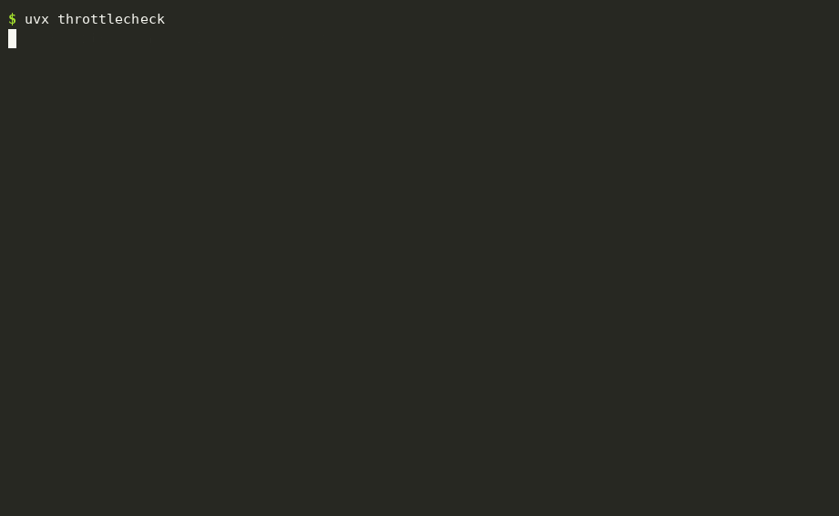

# throttlecheck

**Your speed test says 400 Mbps. So why does Netflix buffer?** Speed tests measure the one server your ISP knows you're testing with. throttlecheck downloads from Netflix's own video servers, a public video stream and the big download CDNs, side by side with a neutral control, and shows you which ones your internet provider is holding back.

```bash
uvx throttlecheck
```

<p align="center"></p>

<sub>Demo with made-up results, generated by <a href="docs/demo.py">docs/demo.py</a>.</sub>

## What it tests

| | Where the bytes come from |
|---|---|
| **Control** | Cloudflare's speed-test server |
| **Netflix** | Netflix's Open Connect video servers, the same machines that stream your shows (handed out by fast.com) |
| **Streaming video** | the segments of a public HLS video stream on Apple's CDN, fetched like a player would |
| **Google, Microsoft, Amazon** | large public downloads from each company's CDN |

Each one gets 4 parallel downloads for 8 seconds; the first 1.5 seconds are ignored while connections speed up. The control runs first and last, and the faster of the two is the baseline.

## How it decides

- **Looks throttled**: under 25% of the control, or under 60% and **flat**. A rate limiter holds speed at one number (mobile carriers like 1.5, 3 or 5 Mbps for video); a busy network goes up and down.
- **Slower**: under 60% of the control without the flat line. Could be throttling, could just be a server further away.
- **Normal**: everything else.

Throttling is usually by time of day or by plan, so run it a few times, including at busy evening hours, before calling your ISP. Mobile hotspots and "unlimited" phone plans are where you're most likely to see it.

## Options

```
throttlecheck                       # everything
throttlecheck --only netflix        # control + Netflix
throttlecheck --seconds 15          # longer, steadier measurements
throttlecheck --streams 8           # more parallel connections (fast fiber)
throttlecheck --json                # for scripts and cron
```

A full run downloads a few hundred megabytes on a fast connection; mind your data cap on mobile.

## Install

```bash
uvx throttlecheck           # run without installing
pipx install throttlecheck  # or install it
```

Requires Python 3.9+. The only dependency is `rich`. macOS, Linux and Windows.

## License

MIT
